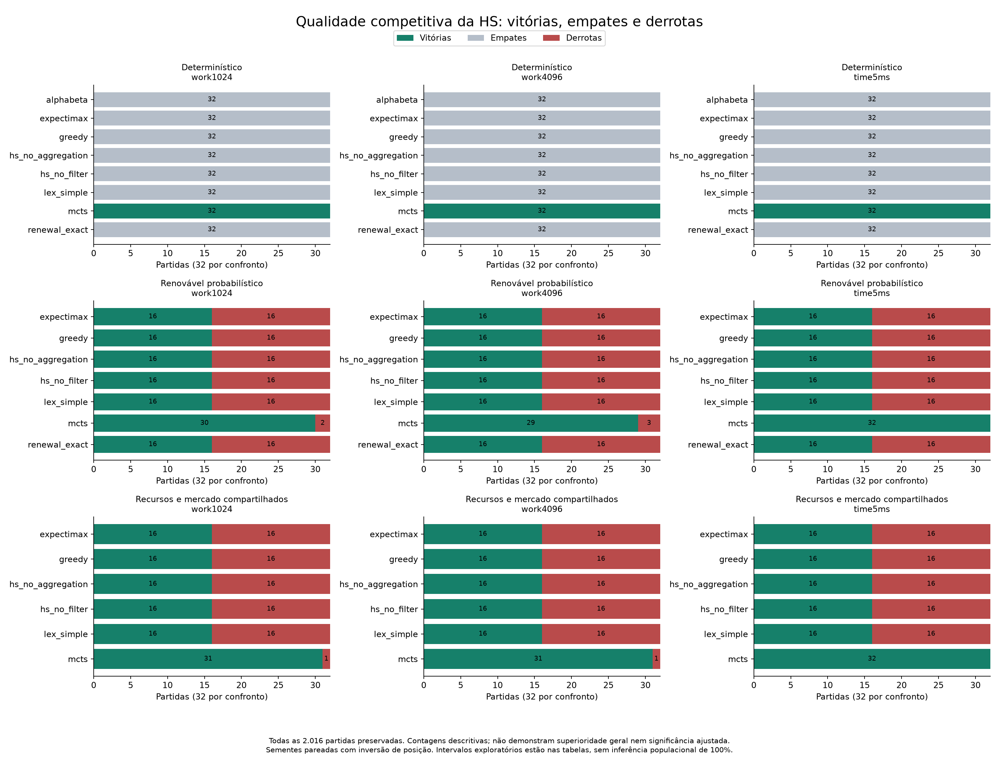
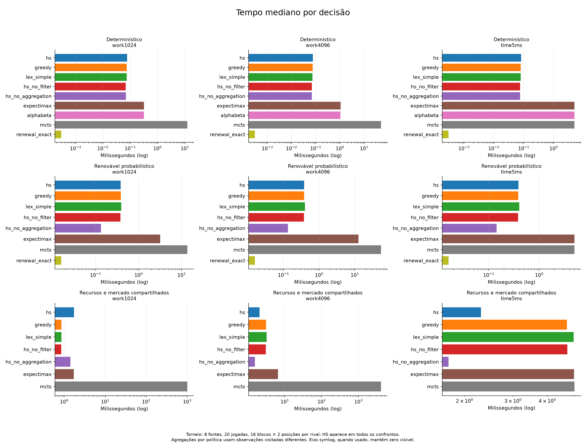
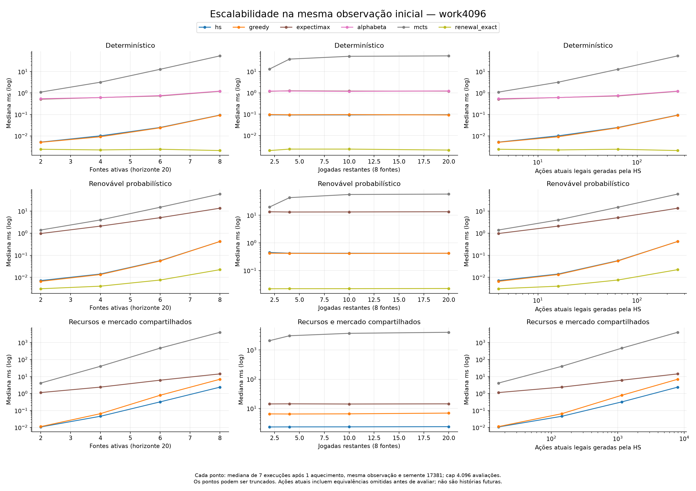
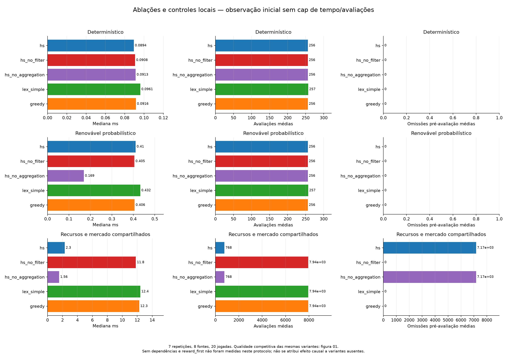

# H-Suppression como arquitetura de decisão: resultados intermediários

Entrega ao professor Aramuni. Experimento de referência: `futures-2026-10-02`. Este trabalho organiza evidências existentes; não modifica ou otimiza as políticas.

## Introdução

Uma decisão pode combinar muitos elementos presentes e ainda ter consequências distribuídas por um horizonte extenso. Enumerar histórias de ações e resultados pode produzir árvores enormes. Isso não torna automaticamente o problema difícil: dominância, separabilidade e equivalências podem permitir soluções locais. A pergunta experimental é quando avaliar ações atuais sem expandir estados sucessores oferece boa relação entre qualidade e custo, e quais componentes explicam essa vantagem.

H-Suppression (HS) combina avaliação matemática de ações admissíveis, prioridade lexicográfica e supressão de alternativas. Utiliza ferramentas conhecidas, como composição afim, Bernoullis, convolução, equivalência e seleção incremental. A contribuição investigada é arquitetural; não se apresenta uma nova fórmula matemática nem se assume uma vantagem exclusiva da combinação.

## Método em síntese

O motor sintético permite preparações, subconjuntos de ativações, efeitos ordenados, recursos, probabilidades e mercado compartilhado. A HS avalia uma ação atual sem construir o próximo estado. Compara primeiro probabilidade de atingir a meta, depois crescimento, variação de dinheiro e pontuação esperada. Omite trocas imediatamente equivalentes antes da avaliação e retém o vencedor corrente após comparar candidatos avaliados. Essas operações estão mapeadas ao código na [metodologia](METODOLOGIA.md).

Foram preservadas todas as **2.016 partidas, 40.320 decisões**, 2.688 medições de escala, 119 controles locais sem caps de tempo/avaliações e nove decisões em pequenos oráculos. Três famílias contrastam renovação gratuita probabilística, renovação determinística e recursos/mercado compartilhados. Cada confronto tem 16 blocos de sementes e duas posições, nos regimes work1024, work4096 e time5ms. Há zero ações inválidas e zero sucessores hipotéticos expandidos pela HS. O compilador de referência é GCC 15.2.0, C11, Release, em Intel i5-1035G1.

Expectimax, alfa-beta e MCTS são referências simples. Greedy e lex_simple compartilham a avaliação analítica; renewal_exact explora explicitamente dominância nas famílias em que ela é válida. As ablações medidas removem agregação ou filtro. Sem dependências e reward_first existem no código, mas não foram medidas neste último torneio: sua ausência não foi preenchida com valores inventados nem misturada com outro protocolo.

## Resultados competitivos

HS venceu o MCTS medido em **32/32 partidas determinísticas em cada regime**. No renovável foram **30/32, 29/32 e 32/32**; no compartilhado, **31/32, 31/32 e 32/32**, respectivamente work1024, work4096 e time5ms. As derrotas restantes são mantidas. Contra os demais rivais, o determinístico teve 32 empates por célula; nos casos probabilísticos foram 16 vitórias e 16 derrotas, com margem média zero. Isso não demonstra ganho competitivo próprio sobre os controles locais especializados.

As [tabelas completas](dados/derivados/RESULTADOS.md) mostram cada célula, margens e intervalos exploratórios. São reamostragens pareadas, sem correção múltipla. Um intervalo `[1,1]` neste conjunto não garante 100% de vitórias em uma população. Oponentes recebem a mesma informação, mas seus modelos de escolha e contagens de trabalho diferem.

## Custo e escalabilidade

Para comparar custo em observações equivalentes, considere a sondagem inicial com oito fontes, 20 jogadas e work4096, mediana de sete repetições. No renovável, HS leva **0,419049 ms**, Expectimax **13,410602 ms**, MCTS **58,376167 ms** e renewal_exact **0,022279 ms**. HS avalia 256 ações, enquanto o controle especializado avalia uma. Portanto, uma árvore hipotética enorme não impede um algoritmo clássico especializado de ser ainda mais barato.

No compartilhado, HS leva **2,370367 ms**, Greedy **6,911835 ms**, Expectimax **14,332019 ms** e MCTS **4.046,460677 ms** nessa sondagem. Esses números pertencem ao regime de avaliações, sem prazo da política. Não significam que MCTS ignorou um limite de 5 ms. HS faz 768 avaliações e zero transições hipotéticas; Expectimax realiza 4.096 avaliações e 104.720 transições, sem completar a primeira camada; MCTS realiza 4.096 avaliações e 4.095 transições. A contagem de avaliações por si só não prevê tempo.

As curvas variam fontes, ações atuais e horizonte; cada ponto identifica o mesmo protocolo e pode ser truncado. Nas famílias renováveis, existem `2^n` subconjuntos atuais. Sem reunir equivalências, a soma de ramificações ação/resultado por turno é `Σ_k C(n,k)2^k=3^n`, produzindo `3^(nH)` folhas. Para oito fontes e 20 jogadas, são aproximadamente **2,185×10^76 histórias**; fixar a ação completa ainda admite `2^160≈1,462×10^48` sequências de resultados. No determinístico há `2^160` histórias de ações. Em shared, `3^80≈1,478×10^38` é apenas um limite inferior de uma subárvore sempre legal.

Essas grandezas **não são estados distintos, nós visitados nem operações eliminadas pela HS**. HS ainda enumera ações atuais, e suas distribuições podem ser exponenciais. O teste alcança oito ensaios aleatórios; não demonstra escalabilidade irrestrita.

## Ablações e atribuição dos ganhos

Sem caps de tempo/avaliações, na observação inicial shared, o fluxo gera **11.008 candidatos**, rejeita **3.072 inválidos**, omite **7.168 trocas equivalentes** e avalia **768**. Sem filtro são **7.936 avaliações**. A mediana HS é **2,296760 ms**, contra **11,814665 ms** sem filtro. Isso sustenta a utilidade deste filtro estrutural nesta implementação e instância. O custo de gerar as trocas não desaparece.

No renovável, **sem agregação foi mais rápido**: **0,169291 ms** contra **0,410491 ms** da HS completa; em shared, **1,559932 ms** contra **2,296760 ms**. Os pesos binários preservam resultados distintos, limitando a compressão; a rotina explícita pode ter menor overhead. Não se conclui que agregação é sempre vantajosa. O teste unitário homogêneo comprova compressão matemática, mas não substitui comparação de tempo em outros domínios.

Lex_simple usa as mesmas prioridades e, quando completo, fornece a mesma seleção local, mas armazena candidatos. Na observação shared sem caps, seu heap próprio máximo é **589.824 bytes**, contra zero alocações próprias HS; pilha e runtime não estão incluídos. Essa economia decorre da seleção incremental e poderia ser adotada por outro seletor convencional. A vantagem não estabelece novidade matemática.

**O conjunto não isola uma vantagem exclusiva da combinação agregação + prioridade + supressão.** Há evidência de ganhos do filtro em shared e de evitar planejamento temporal desnecessário nos casos de renovação. O controle renewal_exact e a variante sem agregação impedem atribuir toda a vantagem à arquitetura completa. Um desenho fatorial com todas as ablações, outros domínios e controles fortes seria necessário para uma conclusão causal mais ampla.

## Interrupções e memória

O histórico não registra causa individual além de `truncated=true`. A auditoria encontrou compatibilidade com o único cap ativo de cada regime, sem extrapolação de avaliações. O prazo de 5 ms é cooperativo: 2.457 decisões o excederam, máximo 5,118448 ms, inclusive 20 sem flag. Não há evidência de memória esgotada, estouro de pilha ou falha de processo. Aprofundamento interrompido conserva a última camada completa ou, se nenhuma completou, um candidato raiz inteiramente processado; na ausência deste, passa.

As [figuras de truncamentos](graficos/05_truncamentos.png) medem o flag, não uma causa instrumental. MCTS não certifica completude nem quando termina normalmente as iterações. [Memória](graficos/08_memoria.png) é heap próprio rastreado, separado do RSS do processo e da pilha não medida. Consulte a [auditoria por política](dados/derivados/limites.csv) antes de interpretar zero heap como baixo consumo total.

## Por que H-Suppression foi escolhida para o agente Derrisor?

Balatro combina mãos de cartas, coringas que alteram pontuação ou recursos e consumíveis que modificam o baralho; a loja e as restrições dos rounds mudam as opções disponíveis. Essas características básicas são descritas na [FAQ oficial](https://www.playbalatro.com/faq). A motivação do Derrisor considera também efeitos aditivos, multiplicativos, condicionais e probabilísticos, sua ordem, limites de compra/venda/descarte/uso e informação incompleta sobre acontecimentos futuros.

A hipótese de engenharia é avaliar matematicamente combinações admissíveis no estado observado e escolher por prioridades determinísticas, em vez de depender de uma árvore temporal extensa a cada decisão. Isso permite incorporar distribuições atuais e interações entre modificadores, rastrear por que uma ação venceu e adaptar a escolha conforme inventário, recursos e metas mudam. HS pode avaliar consequências imediatas e ações compostas; ausência de sucessores não significa ignorar efeitos.

As vantagens pretendidas são menor dependência de expansão temporal, uso explícito das informações disponíveis e decisões auditáveis. Há custos: a enumeração presente pode explodir, a avaliação depende de hipóteses probabilísticas, prioridades inadequadas podem sacrificar recompensa e efeitos de longo prazo podem ser mal representados. O contraexemplo `temporal_counterexample()` preservado nos testes produz utilidade **23 para HS contra 130,2 para o oráculo**, pois investir agora permite pontuar mais depois. É evidência concreta de uma limitação estratégica quando as politicas não são catalogadas consistentemente.

Os cenários sintéticos representam partes dessa motivação, especialmente efeitos combinados, recursos e custo de planejamento. Não reproduzem todo Balatro, suas cartas, coringas, consumíveis, descarte ou incertezas. **Não foi medida superioridade da HS em Balatro.** A escolha para Derrisor é uma hipótese arquitetural justificável e testável, não uma conclusão de vitória sobre todos os planejadores.

## Limitações e próximos passos

Amostra sintética pequena, horizonte limitado, concorrentes simples, tempo cooperativo e memória parcial restringem generalização. O último protocolo não identifica o efeito separado de remover dependências ou trocar prioridades. A seleção incremental e a equivalência são técnicas conhecidas. Resultados negativos, empates e o contraexemplo temporal permanecem documentados.

Próximos estudos, fora desta entrega: tarefas reais de Balatro com protocolo fixado antecipadamente; controles com transposições, programação dinâmica e redução algébrica; todas as ablações em desenho comparável; sementes e máquinas independentes; medição de pilha/memória e causas explícitas de parada. Qualquer nova instrumentação ou alteração deve gerar uma versão e uma execução novas. Consulte [LIMITACOES.md](LIMITACOES.md) e a [bibliografia](referencias/README.md).
